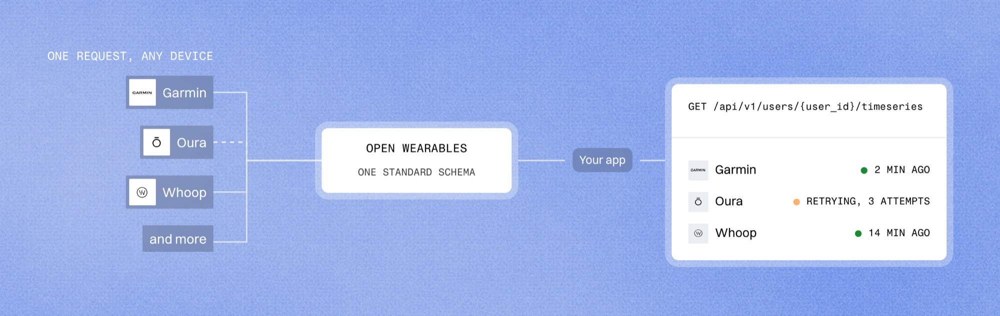

# [Open Wearables](https://openwearables.io/?utm_source=github&utm_medium=readme&utm_campaign=open-wearables)

**Open-source, self-hosted wearable data layer: one API and one schema for the devices your users already wear.**

[](https://github.com/the-momentum/open-wearables)
[](https://github.com/the-momentum/open-wearables/releases)
[](LICENSE)
[](https://discord.gg/qrcfFnNE6H)
[](https://www.producthunt.com/products/open-wearables?embed=true&utm_source=badge-featured&utm_medium=badge&utm_campaign=badge-open-wearables-3)

[Website](https://openwearables.io/?utm_source=github&utm_medium=readme&utm_campaign=open-wearables) · [Documentation](https://openwearables.io/docs) · [Quickstart](https://openwearables.io/docs/quickstart) · [Providers](#supported-providers) · [Roadmap](https://openwearables.io/docs/roadmap)

---

Open Wearables is an open-source platform that connects wearable devices and health apps, standardizes their data into one schema, and serves it through a single REST API. It runs inside your own cloud account, so data goes from each provider straight to your deployment without passing through a third party.

Instead of building and maintaining a separate integration for Garmin, Oura, Whoop, Polar, Apple Health, Samsung Health, Google Health Connect and the rest, you deploy one service. It handles provider OAuth, background sync, webhooks and mobile SDK uploads, and your product reads sleep, activity, workouts and heart rate the same way whatever device the data came from. A built-in MCP server lets LLMs and AI agents query the same data.

It is built for teams whose product runs on wearable data: digital health products and health data platforms, care programs, hospitals and telemedicine, remote patient monitoring, clinical research and more. See [who runs Open Wearables in production](https://openwearables.io/case-studies?utm_source=github&utm_medium=readme&utm_campaign=open-wearables).



## Why self-hosted

Open Wearables runs on your own infrastructure. In practice that means:

- **You decide where the data lives.** Deploy to whatever cloud and region your requirements call for (HIPAA, GDPR, internal policy) and control who has access.
- **Provider apps and tokens belong to you.** You register the developer apps with Garmin, Oura, Whoop and others under your own account, and OAuth tokens are stored in your database.
- **Nobody sits between you and the provider.** Data goes from the provider's API straight to your deployment, without passing through any third-party service.
- **MIT licensed.** Read the code, change it, fork it, run it in production. If you fix or build something others could use, we'd be happy to take it upstream. See the [contributing guidelines](CONTRIBUTING.md) to get started.

## How it works

1. **Connect.** A user links a wearable account through a connection link, or syncs Apple Health, Samsung Health or Health Connect from the phone through a mobile SDK.
2. **Sync.** Open Wearables pulls data through provider webhooks and scheduled syncs, including a historical backfill on first connection.
3. **Standardize.** Every record is mapped into one unified data model in your PostgreSQL database. If you want the originals too, raw provider payloads can be captured to S3 before processing.
4. **Notify.** Your app receives an outgoing webhook when new data arrives.
5. **Query.** Your app reads the data through one REST API, in the same shape whichever provider it came from.

## Supported providers

**Cloud providers**, connected server to server through OAuth:

[Garmin](https://openwearables.io/docs/providers/garmin-api-integration) · [Oura](https://openwearables.io/docs/providers/oura-api-integration) · [Whoop](https://openwearables.io/docs/providers/whoop-api-integration) · [Polar](https://openwearables.io/docs/providers/polar-api-integration) · [Suunto](https://openwearables.io/docs/providers/suunto-api-integration) · [Strava](https://openwearables.io/docs/providers/strava-api-integration) · [Withings](https://openwearables.io/docs/providers/withings-api-integration) · [Ultrahuman](https://openwearables.io/docs/providers/ultrahuman-api-integration) · [SensorBio](https://openwearables.io/docs/providers/sensorbio-api-integration) · [Google Health](https://openwearables.io/docs/providers/google-api-integration) · [Fitbit](https://openwearables.io/docs/providers/fitbit-api-integration) (legacy)

**On-device sources**, read on the phone through the mobile SDKs:

[Apple Health](https://openwearables.io/docs/providers/apple-health) (HealthKit) · [Google Health Connect](https://openwearables.io/docs/sdk/android/integration) · [Samsung Health](https://openwearables.io/docs/sdk/android/integration)

**Apple Health export:** upload a full Apple Health XML export, [large files included](https://openwearables.io/docs/api-reference/guides/apple-xml-import).

> [!NOTE]
> Google is turning off the Fitbit Web API on November 2, 2026. For Fitbit devices, use the Google Health integration.

See [data coverage](https://openwearables.io/docs/providers/coverage) for what each provider delivers. Missing a provider? Check the [open provider requests](https://github.com/the-momentum/open-wearables/issues?q=is%3Aissue%20label%3Aprovider-request%20state%3Aopen) or read [how to add a new provider](https://openwearables.io/docs/providers/supported#adding-new-providers).

## Data you get

| Category | Examples |
| --- | --- |
| Daily summaries | Activity (steps, calories, intensity minutes), sleep, body, recovery |
| Sleep and workouts | Sleep sessions with stages, naps, workouts with samples, personal records |
| Time series | Heart rate, HRV, SpO2, weight, steps, energy and [many more data types](https://openwearables.io/docs/architecture/data-types) |
| Nutrition | Meals with energy and macronutrients, from the sources that provide them |
| Women's health | Menstrual cycle records |
| Provider metrics | Values computed by the device provider itself, stored as reported and labeled with their source |

## Quickstart

Run Open Wearables locally with Docker in a few minutes.

```bash
git clone https://github.com/the-momentum/open-wearables.git
cd open-wearables

cp ./backend/config/.env.example ./backend/config/.env
cp ./frontend/.env.example ./frontend/.env

docker compose up -d
```

- **Developer portal:** http://localhost:3000. Create API keys and add provider credentials here.
- **API docs (Swagger):** http://localhost:8000/docs
- **Sample data (optional):** `make seed` creates test users with activity data.

> [!WARNING]
> An admin account is created on first startup from the `ADMIN_EMAIL` and `ADMIN_PASSWORD` variables (defaults: `admin@admin.com` / `your-secure-password`). The seed runs only while no developer account exists, so changing `ADMIN_PASSWORD` later does not update it. **Set your own `ADMIN_PASSWORD` before the first start, or change the default password in the developer portal right after your first login.** With `ENVIRONMENT=production` the default password is refused: a fresh deployment does not start until `ADMIN_PASSWORD` is set, and an admin that still has the default cannot sign in until you set `ADMIN_PASSWORD` (with `ADMIN_EMAIL` matching that account's email) and restart the backend, which then changes that account's password to it.

**Running in production**

`docker compose up` builds from local source and is meant for development. On any server reachable from the internet set `ENVIRONMENT=production`, which refuses the default admin password. In production, run the official images pinned to a release tag, not `nightly` or a build of `main`:

- [`themomentum/open-wearables-backend`](https://hub.docker.com/r/themomentum/open-wearables-backend)
- [`themomentum/open-wearables-frontend`](https://hub.docker.com/r/themomentum/open-wearables-frontend)

Follow the [Docker deployment guide](https://openwearables.io/docs/deployment/docker) and read the [release notes](https://github.com/the-momentum/open-wearables/releases) before upgrading.

**Local development without Docker**

See the [local development setup](https://openwearables.io/docs/quickstart#local-development-setup) in the docs and [CONTRIBUTING.md](CONTRIBUTING.md).

## Features

### Unified API and data model

- One REST API with OpenAPI documentation, consistent regardless of the source device.
- Daily summaries, time series and events (workouts, sleep sessions) in a [unified data model](https://openwearables.io/docs/architecture/unified-data-model).
- **Data priorities:** decide which provider and device type wins when sources overlap.
- **Multi-account sync:** one provider account can be linked to several user profiles.

### Connections and sync

- OAuth flow management through a connection link: the user picks their provider, authenticates, and data starts syncing.
- Historical backfill on first connection, within each provider's limits.
- Live sync progress as a server-sent event stream, plus sync run history in the API and the portal.

### Webhooks

Register HTTPS endpoints and get notified when new data arrives. Filter by event type or user, verify signatures, send test events and inspect every delivery attempt. Outgoing webhooks are off by default, see [how to enable them](https://openwearables.io/docs/api-reference/guides/webhooks#overview) in the webhooks guide.

### Mobile SDKs and app

Apple Health, Samsung Health and Health Connect keep data on the phone, with no cloud API. The SDKs read it on the device and upload it to your deployment.

| SDK | Platform |
| --- | --- |
| [iOS SDK](https://github.com/the-momentum/open_wearables_ios_sdk) | Swift, Apple HealthKit |
| [Android SDK](https://github.com/the-momentum/open_wearables_android_sdk) | Kotlin, Samsung Health and Google Health Connect |
| [Flutter SDK](https://github.com/the-momentum/open_wearables_health_sdk) | Dart wrapper around the native SDKs |
| [React Native SDK](https://github.com/the-momentum/open-wearables-react-native-sdk) | TypeScript wrapper around the native SDKs |

No app of your own yet? A simple demo app syncs on-device health data to your instance with an invitation code ([setup guide](https://openwearables.io/docs/app/introduction)). TestFlight (iOS) and APK (Android) builds are available on request in [Discord](https://discord.gg/qrcfFnNE6H).

For production use, [Open Wearables Connect](https://openwearables.io/platform/connect-app?utm_source=github&utm_medium=readme&utm_campaign=open-wearables), a full-featured app, is coming soon to the App Store and Google Play. A white-label version, published in the stores under your own brand, will be available as well.

### MCP server for AI agents

A built-in [Model Context Protocol](https://modelcontextprotocol.io) server gives Claude Desktop, Cursor and other MCP clients access to your users' wearable data. Ask "How did John sleep last week?" and the model fetches the right records itself. Keep in mind that the records it fetches are sent to the model provider behind your MCP client.

Tools: `get_users`, `get_activity_summary`, `get_sleep_summary`, `get_workout_events`, `get_timeseries`, `get_menstrual_cycles`. Setup: [MCP server docs](https://openwearables.io/docs/mcp-server).

### Developer portal

A web dashboard with light and dark themes, usable on a phone:

- **Dashboard** with users and data points at a glance.
- **Users:** connected sources and data explorers for activity, sleep, workouts, body, meals and women's health.
- **Coverage and syncs:** which data types each provider delivers, and every sync run.
- **Webhooks:** endpoints and delivery debugging.
- **Settings:** API keys, provider credentials, data priorities, data lifecycle, team invitations and a seed data generator.

### Data lifecycle and raw payloads

- Configurable archival and retention of time series data.
- Optional [raw payload storage](https://openwearables.io/docs/dev-guides/raw-payload-storage): capture provider payloads exactly as they were sent, to logs or an S3 bucket, and replay them against new parsing logic. Disabled by default.

## Architecture


| Layer | Technology |
| --- | --- |
| Backend API | FastAPI (Python) |
| Developer portal | SvelteKit and TypeScript (Bun, server-rendered) |
| Storage | PostgreSQL and Redis |
| Background jobs | Celery worker and Celery beat, for syncing and processing |
| Outgoing webhooks | Svix server (optional) |
| Object storage | S3-compatible bucket (optional): raw payloads, Apple Health XML imports, SDK payload offload |
| MCP server | FastMCP, run by your AI client over stdio; it calls the REST API with an API key |
| Monitoring | Flower (optional), OpenTelemetry and Sentry (optional) |
| Authentication | Self-contained, no external auth service |

Each deployment serves a single organization, with no multi-tenancy. Read the [system overview](https://openwearables.io/docs/architecture/system-overview) and the [data flow](https://openwearables.io/docs/architecture/data-flow) for the full picture.

## Roadmap

Current priorities are performance at scale, compliance features for regulated products, data model hardening and faster mobile sync. See the [roadmap](https://openwearables.io/docs/roadmap), and tell us what you need on [Discord](https://discord.gg/qrcfFnNE6H) or in [Discussions](https://github.com/the-momentum/open-wearables/discussions).

## Telemetry

Open Wearables sends a small anonymous usage ping once a day, plus one on startup, to help us see which providers and features are used. It contains a random instance identifier generated locally on first run, the Open Wearables, Python and OS versions, and aggregate, bucketed counts and configuration flags. It never contains health data, user data or credentials. The API logs a notice at startup while telemetry is on.

To turn it off, set `TELEMETRY_ENABLED=false` (or `DO_NOT_TRACK=1`) on the backend containers. The [telemetry docs](https://openwearables.io/docs/dev-guides/telemetry) list every field we collect and why.

## Join the Discord

Talk to the maintainers and other teams building on Open Wearables, get help with your deployment, and hear about releases first.

[](https://discord.gg/qrcfFnNE6H)

## Contributing

Contributions are welcome, from bug reports and small fixes to larger features. Before you write any code, please take five minutes to read [CONTRIBUTING.md](CONTRIBUTING.md): it explains how to agree on a change with us first, how to set up the project, and what we expect in a pull request, which leads to better PRs and quicker reviews. AI-assisted contributions are welcome - just tell us which tools you used and make sure you understand what you are submitting.

Need a provider that isn't supported yet? Open an issue or ask on [Discord](https://discord.gg/qrcfFnNE6H) first so we can agree on scope.

Security issues go through [SECURITY.md](SECURITY.md).

## Community

- [Discord](https://discord.gg/qrcfFnNE6H) for chat and help
- [GitHub Discussions](https://github.com/the-momentum/open-wearables/discussions) for questions and ideas
- [X @openwearablesio](https://x.com/openwearablesio) and [LinkedIn](https://www.linkedin.com/company/open-wearables) for updates
- [openwearables.io](https://openwearables.io/?utm_source=github&utm_medium=readme&utm_campaign=open-wearables) for the project website

## License

[MIT](LICENSE). Use it freely in commercial and open-source projects.

## Pro and Enterprise

The open-source core is free and MIT licensed. For teams that want more on top of their deployment, Open Wearables also comes in Pro and Enterprise tiers:

- **[Connect App](https://openwearables.io/platform/connect-app?utm_source=github&utm_medium=readme&utm_campaign=open-wearables):** the ready-made iOS and Android app for Apple Health, Health Connect and wearable data, with no user limit and an option under your own brand.
- **[Health scores](https://openwearables.io/platform/health-scores?utm_source=github&utm_medium=readme&utm_campaign=open-wearables):** sleep, recovery and activity scores, designed and validated by our science team and consistent across devices.
- **[AI Insights](https://openwearables.io/platform/ai-insights?utm_source=github&utm_medium=readme&utm_campaign=open-wearables):** an AI assistant that analyzes each user's wearable data and answers their questions about it. It runs as an optional service next to your instance and is configured from the dashboard. Bring your own LLM key (OpenAI, Anthropic or Google), set the assistant's tone and task, and add your own domain knowledge.
- **[Medical-grade integrations](https://openwearables.io/pricing?utm_source=github&utm_medium=readme&utm_campaign=open-wearables#modules):** certified medical devices such as CGMs, blood pressure monitors, ECG devices and pulse oximeters, kept up to date by us.
- **[Observability](https://openwearables.io/pricing?utm_source=github&utm_medium=readme&utm_campaign=open-wearables#modules):** sync health per provider and per user, so a broken connection is caught before your users notice.

Enterprise adds ongoing maintenance and SLA support, plus the security and compliance work regulated teams need: audit logging, infrastructure hardening, signed agreements, answers to security questionnaires and delivery under certified quality management. [Compare the plans](https://openwearables.io/pricing?utm_source=github&utm_medium=readme&utm_campaign=open-wearables) for everything each one includes, including deployment in your cloud.

## Built with ❤️ by Momentum

Open Wearables is created and maintained by [Momentum](https://themomentum.ai/?utm_source=github&utm_medium=readme&utm_campaign=open-wearables), a software and AI development agency that turns health data into intelligent products. The backend started from Momentum's [Python AI Kit](https://github.com/the-momentum/python-ai-kit).

**Need customization?** [Talk to us](https://www.themomentum.ai/lets-talk?utm_source=github&utm_medium=readme&utm_campaign=open-wearables).

<a href="https://themomentum.ai/?utm_source=github&utm_medium=readme&utm_campaign=open-wearables">
  <picture>
    <source media="(prefers-color-scheme: dark)" srcset="docs/images/readme/momentum-logo-white.svg">
    
  </picture>
</a>
